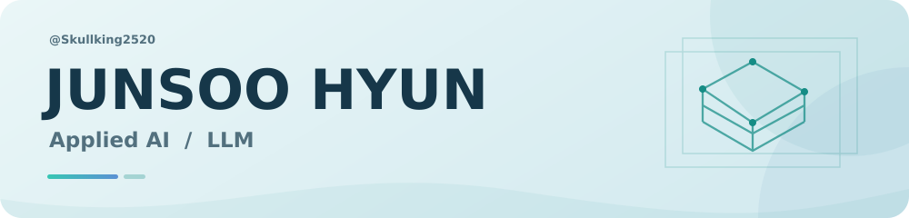

<picture>
  <source media="(prefers-color-scheme: dark)" srcset="assets/banner-dark.svg" />
  
</picture>

<h2 align="center">AI·LLM 엔지니어를 준비하는 현준수입니다.</h2>

  <a href="#대표-프로젝트">대표 프로젝트</a> ·
  <a href="#프로젝트에서-사용한-기술">사용 기술</a> ·
  <a href="#경험과-교육">경험과 교육</a> ·
  <a href="#연락처">연락처</a>

모델 실험과 데이터 구성, 평가 결과를 실제 서비스에 연결하는 개발에 관심이 있습니다. 개인 졸업 프로젝트와 인턴 경험을 쌓았으며, 팀 프로젝트에서는 **서브 PM·AI 파트장**으로 개발 일정과 협업 방향도 조율했습니다.

## 대표 프로젝트

<table>
<tr>
<td width="50%" valign="top">

<h3>뭉치 AI</h3>

<strong>부트캠프 · 통합 팀 프로젝트</strong>

자연어 수요를 구조화하고 수요 통합·판매자 매칭으로 연결하는 서비스의 AI 파트입니다.

<strong>내 역할</strong> AI 파트장 · 일정과 타 파트 협업 조율 데이터·Facet·자연어 수요 라벨링

<a href="projects/moongcheap.md">개인 담당 범위</a> · <a href="https://github.com/V-MoongCheap/MoongCheap-AI/tree/develop">팀 저장소</a>

</td>
<td width="50%" valign="top">

<h3>AI 진로 추천 서비스</h3>

<strong>APU · 개인 졸업 프로젝트</strong>

사용자의 경험과 역량을 ESCO 직업·전공 정보에 연결하는 추천 서비스입니다.

<strong>내 역할</strong> 역량 추출 학습 실험·표준 역량 연결 추천 API와 웹 화면 구성

<a href="https://github.com/Skullking2520/FYP">프로젝트 저장소</a> · <a href="https://github.com/Skullking2520/FYP/blob/main/Model/Train.ipynb">학습 실험</a>

</td>
</tr>
<tr>
<td width="50%" valign="top">

<h3>NewBiz Shield</h3>

<strong>부트캠프 · 팀 프로젝트</strong>

문자·URL·이미지의 스미싱 위험과 판단 근거를 제공하는 AI 서비스입니다.

<strong>내 역할</strong> 서브 PM · 모델 개발 개발 일정 관리와 의견 조율

<a href="projects/newbiz-shield.md">개인 담당 범위</a> · <a href="https://github.com/Skullking2520/kdt-ai-2-team3-advanced">팀 저장소</a>

</td>
<td width="50%" valign="top">

<h3>금융 AI 에이전트 검증 환경</h3>

<strong>부트캠프 · 팀 프로젝트</strong>

가상 자금으로 금융 요청과 승인 흐름, 에이전트의 보안 경계를 검증하는 환경입니다.

<strong>내 역할</strong> DevSecOps · AWS 시연 환경 로컬 레드팀 검증 구현·보완

<a href="projects/financial-agent.md">개인 담당 범위</a> · <a href="https://github.com/siliincer/kdt-ai-2-hands-on-experience">팀 저장소</a>

</td>
</tr>
</table>

팀 프로젝트의 전체 기능은 원본 팀 저장소에, 개인 담당 범위는 이 프로필의 별도 설명에 정리했습니다.

## 프로젝트에서 사용한 기술

#### AI·모델

   

#### 서비스·데이터

   

#### 개발·배포

   

## 경험과 교육

| 구분 | 경험 | 기간 |
| --- | --- | --- |
| 인턴 | **Seeka Technology** · 소프트웨어 개발 · 원격근무 | 2025.01–2025.05 |
| 교육 | **kt cloud TECH UP 2기** · 생성형 AI 과정 수료 | 2026.03–2026.10 |
| 학력 | **APU** · Computer Science 졸업 | 2021.06–2026.07 |

<strong>인턴 업무와 관련 코드 보기</strong>

채용·직업·전문직 정보를 수집하고, 수집한 직무 정보에서 역량과 직무 수준을 추출·분류하는 업무를 수행했습니다.

| 업무 | 관련 저장소 |
| --- | --- |
| 채용 공고 수집 | [SEEK](https://github.com/Skullking2520/seek_action) · [Jora](https://github.com/Skullking2520/jora_scrapping) |
| 직업·채용 정보 수집과 결합 | [YourCareer](https://github.com/Skullking2520/yourcareer-au-scrapping) |
| 등록 전문직 정보 수집 | [PractitionerSearch](https://github.com/Skullking2520/PractitionerSearch) |
| 직무 역량 추출·수준 분류 | [Skillls_extract](https://github.com/Skullking2520/Skillls_extract) |

<strong>학교 수업 과제 보기</strong>

Asia Pacific University of Technology & Innovation 재학 중 수행한 수업 과제입니다.

- [수업 과제 모음](https://github.com/Skullking2520/JunsooHyun_Portfolio): C++ 이메일 관리, Java 생산라인 시뮬레이션, 어셈블리 블랙잭, 영상 처리, Linux 서버 구성
- [블록체인 수업 팀 과제](https://github.com/Skullking2520/BCD): 게임 아이템 거래 웹앱과 스마트 계약

## 연락처

[이메일 보내기](mailto:hyunjunsoo@naver.com) · [프로젝트별 역할 보기](projects/)

hyunjunsoo@naver.com

